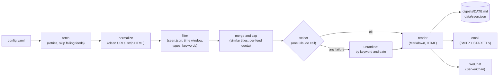

# research-digest

A small Python tool that turns RSS feeds into a daily reading list.

Once a day it fetches arXiv and physics-news feeds, sets aside what it has already
considered, and asks Claude, in a single API call, to pick the ten items that best match
a paragraph describing your interests. The result is sent by email and as a WeChat
message, and is committed to [`digests/`](digests/) as a Markdown file.

It is designed to run unattended on GitHub Actions. If the Claude call fails for any
reason, a digest is still produced: items chosen by keyword and date, marked "unranked".

**Status:** version 0.1. The test suite and the offline dry run pass. It has not run on
GitHub yet; the first real digest will appear in [`digests/`](digests/) after the first
scheduled run.

## How it works



Each processing step is a module in [`digest/`](digest/).
[`digest/pipeline.py`](digest/pipeline.py) calls them in order and is the best place to
start reading. [`DESIGN.md`](DESIGN.md) explains the main decisions, the alternatives,
and how to switch to them.

## Try it offline

No API key, and nothing is sent. After the one-time install it needs no network either.
You need Python 3.14, the only version this code has been run on.

On Windows (PowerShell or cmd):

```powershell
python -m venv .venv
```

```powershell
.venv\Scripts\python -m pip install -r requirements-dev.txt
```

```powershell
.venv\Scripts\python -m digest run --dry-run
```

```powershell
.venv\Scripts\python -m pytest
```

On macOS or Linux the same four commands are `python3.14 -m venv .venv` and then
`.venv/bin/python -m ...`.

The dry run takes the recorded and synthetic feeds in [`fixtures/`](fixtures/) through
normalizing, filtering, merging, selection and rendering, with a fake model that picks
the first ten candidates. It writes three files to `out/`: the Markdown digest,
`email.html` and `wechat.md`. It does not fetch, deliver or touch the seen store; those
parts are covered by the tests. It ignores `config.local.yaml`.

## Run it for real on your machine

Set `ANTHROPIC_API_KEY` in your environment, then:

```powershell
.venv\Scripts\python -m digest run --no-send
```

This fetches the live feeds, makes one Claude call (under one US cent, see
[Cost](#cost)), writes `digests/YYYY-MM-DD.md` and updates `data/seen.json`. Without
`--no-send` it also delivers, using the environment variables listed below.

Those two paths are the ones the scheduled job will commit every day. Once the job is
running, do not commit them from your machine: undo a local run with
`git restore data/seen.json` and delete the new file in `digests/` before you pull.

## Configuration

Everything is in [`config.yaml`](config.yaml), which is commented. The keys you are most
likely to change:

| Key | Default | Meaning |
|---|---|---|
| `interests` | a paragraph | What you care about. Claude reads this text as written. |
| `feeds` | 2 arXiv feeds, 3 news feeds | Name, URL and a per-feed `quota` of candidates. |
| `watch_authors` | empty | New papers by these authors always make the digest. Names match as whole words; write them in full. |
| `priority_keywords` | a short list | Decide which items go first when a feed exceeds its quota, and in unranked digests. |
| `top_k` | 10 | Entries in the digest. |
| `max_candidates` | 150 | Most items shown to the model in one call. |
| `lookback_hours` | 36 | Items older than this are ignored. |
| `model` | `claude-haiku-5-5` | Any Claude model that supports structured outputs. |

For private settings, create `config.local.yaml` next to it. It is gitignored, and any
top-level key in it replaces the same key in `config.yaml`:

```yaml
watch_authors:
  - Jane Q. Example
top_k: 15
```

The tests do not depend on these settings. They do depend on the list of feeds: if you
add or remove a feed or change a quota, see section 17 of [DESIGN.md](DESIGN.md).

## Deploy on GitHub Actions

These steps use the [GitHub CLI](https://cli.github.com). Install it and run
`gh auth login` once. Without it, the same can be done on github.com: create an empty
public repository, `git remote add origin <its URL>`, `git push -u origin main`, and add
the secrets under Settings → Secrets and variables → Actions.

1. Create the repository and push this code:

   ```bash
   gh repo create research-digest --public --source=. --push
   ```

2. Add the secrets. Each command prompts for the value, so it never appears in your
   shell history:

   ```bash
   gh secret set ANTHROPIC_API_KEY
   ```

   | Secret | Needed for | Notes |
   |---|---|---|
   | `ANTHROPIC_API_KEY` | ranking | Without it every digest is unranked. |
   | `SMTP_HOST`, `SMTP_PORT`, `SMTP_USER`, `SMTP_PASS`, `MAIL_TO` | email | Port 587 with STARTTLS. `SMTP_PORT` may be left unset (587). Gmail needs an app password, not your account password. `MAIL_TO` may hold several addresses separated by commas. |
   | `SERVERCHAN_SENDKEY` | WeChat | Must be a ServerChan **Turbo** key (starts with `SCT`). See below. |
   | `MAIL_FROM` | optional | Sender address, if it differs from `SMTP_USER`. |
   | `WATCH_AUTHORS` | optional | Private watch list, names separated by semicolons. |

   A channel whose secrets are missing is skipped. The job fails if every feed fails or
   if every configured channel fails.

3. Trigger a first run from the main branch and watch it:

   ```bash
   gh workflow run daily.yml
   ```

   ```bash
   gh run watch
   ```

After that, [`daily.yml`](.github/workflows/daily.yml) is scheduled for about 12:17 UTC
every day and will commit the new digest and `data/seen.json` as `github-actions[bot]`.
[`ci.yml`](.github/workflows/ci.yml) runs the linter and the tests on every push and pull
request of yours. The job's own daily commit does not trigger it.

### About the WeChat channel

Messages go through [ServerChan](https://sct.ftqq.com), a third-party relay. What
follows is from its documentation; nothing has been sent through it yet.

- Use a Turbo key (`SCT...`). ServerChan's other product has keys starting with `sctp`
  and delivers to its own phone app, not to WeChat. The code refuses those keys.
- On the free plan the WeChat card shows only the title. Tapping it opens a detail page
  with the full text, which ServerChan keeps for about a day. When the job runs on
  GitHub, the message therefore carries, near its top, a link to the permanent copy in
  this repository.
- The free plan allows five messages a day. One digest uses one.
- ServerChan stores the message body on its servers, and anyone with the detail link can
  read it. The digest contains only public paper and news metadata, so this is
  acceptable here. Do not reuse this channel for anything private.

### Scheduled runs can stop

- **The 60-day rule.** In public repositories GitHub disables scheduled workflows after
  60 days without repository activity. This project is expected to commit a digest on
  most days, and in other public repositories such bot commits have kept schedules
  alive, but GitHub does not document what counts as activity. If the Actions tab says
  "This scheduled workflow is disabled because there hasn't been activity in this
  repository for at least 60 days", click **Enable workflow**, or run:

  ```bash
  gh workflow enable daily.yml
  ```

- **Late or missing runs.** GitHub starts scheduled jobs when it has capacity. A run can
  be tens of minutes late, and on a busy day it can be dropped. The arXiv feed only
  holds the current day's papers, so a dropped day is lost. You can always start a run
  by hand with `gh workflow run daily.yml`.

## Cost

One Claude call per run. With the default model the price is $0.10 per million input
tokens and $0.50 per million output tokens (prompts up to 100,000 tokens; Anthropic's
pricing page, October 2026).

A full day's snapshot of the five feeds produced 114 candidates and a prompt of about
91,000 characters, roughly 23,000 to 37,000 tokens. With a few thousand output tokens
that is **under one US cent per run**, a few dollars a year. This is an estimate from an
offline run. Each run that gets a reply logs its real token counts and an estimated
cost, and prints them in the digest footer.

Nothing else costs money. GitHub Actions is free for public repositories and ServerChan
has a free plan.

## Limitations

- arXiv's RSS feed has no history. A day on which the job does not run is not caught up.
- arXiv announces nothing on weekends and its holidays (its feed says it skips
  Saturdays and Sundays). If nothing at all is new, the job makes no API call and sends
  nothing.
- A feed that is cut short in transit but still readable contributes what could be
  read; only the log says so.
- An unranked digest is a rough substitute: ten items picked by keyword and date, and
  news items appear as title and link only.
- The watch list is not named anywhere, but a careful reader of a public archive could
  infer it over time. See [DESIGN.md](DESIGN.md#8-watched-authors).
- Email uses STARTTLS (usually port 587). Servers that only accept port 465 need a
  small change described in DESIGN.md.
- The plain-text part of the email is the Markdown digest, escape codes included. Mail
  clients show the HTML part.
- A story is recognised as a repeat only if its URL is the same, or if two feeds publish
  it under nearly the same title within the same run.
- Author names appear as arXiv writes them, including TeX accents such as `\'e`.
- Web and e-mail addresses inside an abstract are shown as text, and GitHub makes them
  clickable.
- ServerChan reports "accepted", not "delivered to WeChat". A muted or unfollowed
  service account will not be noticed.
- Summaries are written by a language model from a title and an abstract. They can be
  wrong. Follow the link before relying on one.

## Prior art

Daily paper digests are a well-populated category. Before any code was written, the
AI assistant surveyed existing tools; [DESIGN.md](DESIGN.md#2-build-or-reuse) lists the
eight it read in some depth, with their licences and how they call the model. Ideas were
borrowed, for example reading everything from the arXiv RSS feed and filtering by
announce type, as [zotero-arxiv-daily](https://github.com/TideDra/zotero-arxiv-daily)
and [gpt_paper_assistant](https://github.com/tatsu-lab/gpt_paper_assistant) do. No code
was copied.

## How this was built

From a written specification ([SPEC.md](SPEC.md)) by the repository's owner. The code,
the tests and these documents were written with
[Claude Code](https://claude.com/claude-code) (model Claude Opus 5.5), which also ran
the reviews described in DESIGN.md. The commits were arranged into logical steps
afterwards; they are not a minute-by-minute record.

## Project layout

| Path | What it does |
|---|---|
| `digest/pipeline.py` | The whole run, top to bottom |
| `digest/__main__.py` | Command line: `python -m digest run [--dry-run] [--no-send]` |
| `digest/config.py` | Loads and validates `config.yaml` |
| `digest/models.py` | The data shapes passed between steps |
| `digest/fetch.py` | Downloads feeds with timeouts and retries |
| `digest/normalize.py` | Feed entry to `Item`: canonical URL, plain-text summary |
| `digest/dedup.py` | Seen store and near-duplicate titles |
| `digest/prefilter.py` | Time window, keywords, candidate cap |
| `digest/selection.py` | The Claude call, its checks and the fallback |
| `digest/render.py` | Markdown, HTML and the WeChat body |
| `digest/deliver.py` | Email and WeChat, isolated from each other |
| `digest/dryrun.py` | Recorded feeds and a fake model for `--dry-run` |
| `fixtures/` | Recorded and synthetic feeds for the dry run and the tests |
| `tests/` | Offline tests |
| `SPEC.md` | The specification the project was built from |
| `DESIGN.md` | Decisions, alternatives, and how to switch |

## License

MIT. See [LICENSE](LICENSE).

This project is not affiliated with or endorsed by arXiv, APS, Physics World, Quanta
Magazine, ServerChan or Anthropic.
